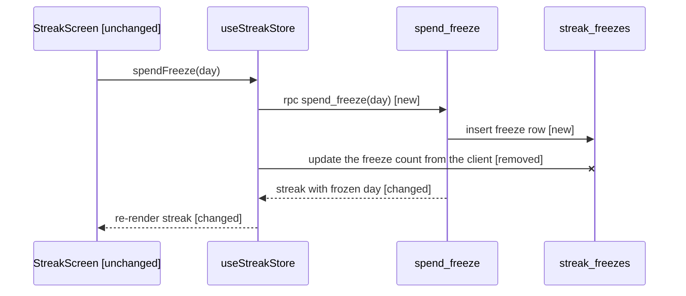
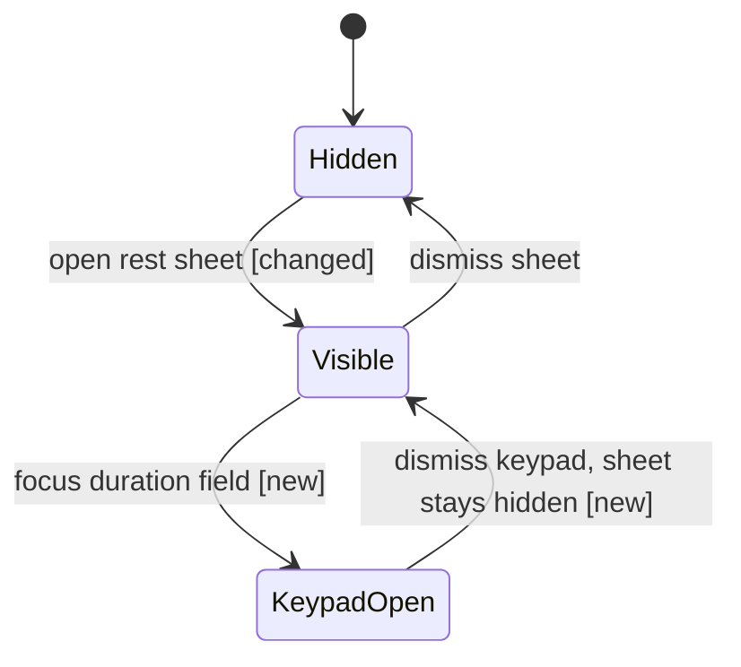

# PR story

A diff arrives in alphabetical order, which is almost never the order it makes sense
in. Re-order it so each file is read after what it depends on, and draw the flows that
carry the most changed code.

## Ground rules, shared by all six pr-* skills

- **Optional.** Nothing here gates a review or a merge; skipping this skill is always fine.
- **Sat acts alone.** Every next step you name is one the user (Sat) can take by
  themselves. On someone else's PR, work only from what already exists: the diff, the
  PR description, the linked ticket and git history. Never suggest asking the author.
- **Read-only.** No comments, reviews, labels, approvals, pushes, commits, checkouts or
  branch changes. No browser, database or running service, not even a read-only
  `SELECT`: no `psql`, no local Supabase or Docker stack. Read with `gh pr view|diff`,
  `gh issue view`, `gh api` GETs, `git fetch` (it adds objects, moves no branch),
  `git show|log|diff|grep|blame|ls-tree|merge-base|config`, `jq`, `mktemp`, `wc`, `date`
  and pr-recall's `python3 store.py`. Scratch files go under `/tmp`; pr-recall's card
  store is the only thing any pr-* skill writes.
- **Budgeted.** The budget is a ceiling, not a target: cut to fit. A line stays one
  line, never sub-bullets or a continuation. Each free-text field (a reason, question,
  claim, fact, correction) is at most 140 characters, in the text and in the JSON.
- **Pinned.** Resolve the head SHA once and compute everything against it. Open with
  the pin line `<owner>/<repo>#<n> @ <sha7>`, outside the budget.
- **Two outputs.** Plain text for Claude Code, then exactly one fenced `json` block with
  the same content, nothing extra, for the Lucidos Pulls app and review-prep rail to store.

## Budget

Up to 3 diagrams, each under a one-line `Flow` label, plus the ordered file list at one
line per step. Besides those, only the "separate things" opener when it applies, and
one line per extra flow.

## Acquire

Input: a PR number in the current repo, `owner/repo#n`, or a PR URL. Pass it to
`gh pr` as `-R <owner/repo> <n>`: gh reads `owner/repo#n` as a branch name. For a
bare number, `<owner/repo>` is `gh repo view --json nameWithOwner -q .nameWithOwner`.

```bash
mktemp -d /tmp/pr-<n>.XXXXXX   # prints <T>: one dir per run
gh pr view -R <owner/repo> <n> --json number,url,title,body,author,state,mergedAt,headRefName,headRefOid,baseRefOid,baseRefName,files,additions,deletions,closingIssuesReferences > <T>/pr.json
jq -r '.headRefOid, .baseRefOid, .baseRefName' <T>/pr.json   # prints <sha>, <base-oid>, <base-ref>; resolve ONCE: FETCH_HEAD is overwritten by any later fetch
gh pr diff -R <owner/repo> <n> > <T>/pr.diff   # the net diff; --patch is a per-commit series that repeats files
git fetch origin refs/pull/<n>/head <base-ref>
git merge-base <base-oid> <sha>   # prints <base>: the before-state
git show <sha>:<path>; git grep -n '<symbol>' <sha>   # read the head without checking it out
date -u +%Y-%m-%dT%H:%M:%SZ   # prints <now>: the JSON generated_at; run it last, just before writing the JSON
```

- **Literals only.** No `$(...)`, backticks or variables: they die between tool calls, and
  a permission guard refuses substitution. Run each command alone, read its output, and
  paste the value into the next command as a literal (`<T>`, `<sha>`, `<base>` above).
- `repo` in the JSON is `owner/name`, taken from the PR URL.
- **Own PR**: `author.login` equals `gh api user -q .login`.
- **Not cloned locally** (or `origin` is another repo): read files with
  `gh api "repos/<owner/repo>/contents/<path>?ref=<sha>" -H 'Accept: application/vnd.github.raw'`
  and history with `gh api "repos/<owner/repo>/commits?path=<path>"`.

## Step 1 — Order the files

Group every changed file into steps, so that each file comes after what it depends on.

- The default order is types → data → logic → UI → tests. Rename the layers to fit the
  repo: migrations → RPCs → store → screens → tests for a Supabase app, models →
  services → view models → views → tests for a Swift one.
- Config and CI go where they take effect. pr-lanes' Trust-class files (docs, QA specs,
  translations, fixtures, generated code, agent prompts that change no gate) go in a
  final `skip` step: docs are never a layer. Files in an import cycle share one step,
  at the earliest layer among them.
- At most 8 steps, not counting `skip`: merge the smallest adjacent ones to fit. A PR
  of Trust-class files only (docs, skills, slash commands) orders them in the steps.

Line: `<n>. <layer> — <files> — <what changes>`. Name at most 4 files per line by
basename, then `+N more`. Colliding basenames take the shortest unique tail of their
path: `en-US/translations.json`, `de-DE/translations.json`.

Done when every changed file sits in exactly one step: count them against `files` in
the metadata.

## Step 2 — Find the flows

A **flow** is one distinct behaviour change, traced from the entry point that runs it
through the changed code. Its `kind` names that entry: `screen` (a screen action),
`endpoint`, `job`, `cli` (a CLI or slash command), `webhook`, `event` (an SDK, realtime
or OS callback), `launch` (app start, a root mount effect), else `other` (a git or
agent hook). Walk each changed function's callers up (`git grep -n '<name>' <sha>`).
A **changed function** is the innermost named function around a changed line (a
declaration, a method, `const onSave = …`); an inline callback, such as an effect body,
belongs to the one around it, and outside any function the changed hunk stands in.
Imports and module-level constants and types are never one: they score with the flow
that uses the name.

- **One flow per top changed function**, never one per caller. A top is a changed
  function that no other changed function calls (in a cycle, the first by path); every
  changed function it calls joins its flow, and however many callers reach it, it stays
  one flow. Two tops are two flows, even from one tap. Counts: nine screens calling
  three changed store functions are 3 flows; a changed `onSave` calling a changed
  `saveStreak` is one flow, `onSave`'s, since `saveStreak` has a changed caller.
  Doesn't: 9 flows, one per screen, or `saveStreak` as a second flow.
- **Entry.** The flow's `entry` is what runs its top function: `<Screen>: <action>`
  for a screen (`StreakScreen: tap Use freeze`, `StreakScreen: opens`), else the route,
  command or callback by name (`nightly streak_reset job`). When its callers disagree,
  take the first by `kind` in the order above, then by path, then by line; the rest add
  nothing. A tap on a control, even in a sub-component its screen always mounts, is an
  action on that screen and never a trigger of its own: it names the entry and never
  splits or adds a flow, the changed function does. A sub-component has an entry of its
  own only when the user can reach it without the screen: a route of its own, a deep
  link, a notification. Counts: taps on `ConsistencyCard` and on the header both call
  the changed `refresh`: one flow, `StreakScreen: tap consistency card` if that
  caller's path sorts first. Doesn't: a second flow `ConsistencyCard: tap` for that
  `refresh`. A card handler that is itself changed and has no changed caller is a
  second top, so a second flow, still entered under `StreakScreen`.
- **Kind**, from what makes the top function run. A callback fired by something other
  than a person on the screen (an SDK, a realtime message, a push, an OS lifecycle
  hook, an in-app EventBus) is `event`, entered at the callback: the walk stops at the
  bus, never on to whoever emits. A person acting on or opening a screen (a tap, a
  submit, navigating there, its mount effect, a passive render, a DOM or page load of
  a route) is `screen`, entered `<Screen>: opens` when nothing is tapped. App start
  with no screen (a mount effect in the root layout or a provider, the root document's
  bootstrap) is `launch`. A schedule or queue with nobody present (cron, pg_cron, a
  worker, an OS background task) is `job`. Counts: `StreakScreen` loading on mount is
  `screen`; the root layout's push-token effect is `launch`; the `onDone` callback of
  a `workout:done` bus event is `event`; `reset_streaks` on pg_cron is `job`. Doesn't:
  a mount effect that only subscribes (its callback is the `event`); a `setInterval` a
  mounted screen starts (the screen's flow, not a `job`).
- A moved registration (a listener, a subscription, a bridge holding one) is one flow,
  entered at the callback where its effect is observed, not where it is registered:
  its `kind` is the callback's.
- Score a flow by its **changed lines**, each once: the added plus removed lines of
  `git diff -w <base> <sha>`, not counting blank or comment-only lines (in a markdown
  or skill file: fence delimiters, headings, `#` comments inside a fenced shell
  snippet, and a prose line that is only reworded, so it gives the same instruction as
  before). Every count uses them: the size gate, Step 3's pick, `changed_lines`.
  A line **serves** a flow when that flow's behaviour change depends on what the line
  changes, not just because the flow runs it: a fixed query bound serves the flow cut
  for that fix, not every flow reading its rows. A line serving two flows scores in
  the one with more categories (Step 3's test), then more changed lines, both without
  shared lines.
- **A migration restating a SQL function** (`create or replace function`, or a drop
  and create) scores only the lines that differ from that name's previous definition,
  never the restated body. Find the previous one at `<base>`: the snapshot of the
  schema's functions the repo keeps (a `pgprocedures` file, `supabase/schemas/`), else
  the highest-named earlier migration defining it: `git grep -n -i -w
  'function.*<name>' <base> -- '*.sql'` lists both. Write each body to `<T>/old.sql`
  and `<T>/new.sql` and run `git diff --no-index -w -U0 <T>/old.sql <T>/new.sql`
  (it exits 1 when they differ): the changed lines it prints, not its file headers and
  not blanks or comments, are the score. With no previous definition the function is
  new and its whole body counts; the migration's other statements count in full.
  Counts: `0043_streak_fix.sql` restates the 300-line `spend_freeze`, and 12 lines
  differ from `0042`'s: 12. Doesn't: 300, or lines that only changed indentation.
- **A pure refactor** (every caller sees the same returns, writes, navigations and
  throws; the code is only cleaner or faster) never cuts a flow. Its lines serve the
  flows that other lines cut and that run it, placed by the rule above; the rest sit
  in no flow, and a PR of nothing else has no flows (below). Counts: extracting
  `computeStreak` from `spendFreeze` with the same results, in a PR whose new RPC call
  cuts the `spendFreeze` flow: the extracted lines score there. Doesn't: a "refactor"
  after which a caller sees another write, throw or order. That is a behaviour change
  and cuts a flow like any other.
- A flow left with no lines of its own is **emptied**: it stays, with 0 changed lines,
  in the group of the flow that took most of its lines. It never makes a group a thing
  or a small fix, and is never diagrammed.
- In no flow: Trust-class files and tests. Agent markdown (a skill, a slash command,
  `CLAUDE.md`) joins a flow only through its gate-changing lines, starting at what runs
  them: only those lines score, and only their categories count.
- A line is **gate-changing** (pr-lanes' `gate`) when it alters whether, when or by
  whom a review, merge, auto-merge, release or CI skip may happen: in code, or in an
  agent prompt, skill or hook by changing what the agent or script may or must do at
  that gate, never by rewording or reporting it differently. These count: a change to
  `SKIP_REVIEW` pushes, auto-merging a PR, a release landing via a PR, skipping a step
  on a staged promote, a new stop condition. These don't: reviewer-prompt wording, a
  message-only hook edit, splitting a command into separate Bash calls.

Nothing that runs changes behaviour (docs or slash-command markdown only, config,
renames, dependency bumps, comment-only trims, a pure refactor, dead code: a function
no caller reaches, or removing an export that `git grep -n '<name>' <base>` finds in no
other file): no flows, so skip Step 3 and output only the file list, with `flows` `[]`,
`diagrams` `[]` and `diagram` `null`. A refactor or dead-code PR is this case, not one flow per caller
or per touched function.

**Groups.** Two flows share a group when one changed function holds lines scored in
each, or when changed lines in each call the same function the diff adds or changes.
A command line that triggers a hook (`git push` running `require-review-before-push.sh`)
calls it only when the diff changes the hook's logic, not just its messages.
A function the PR deletes or splits counts as changed: its pieces are read against it.
Never joined by: a shared file alone, a mechanical call-site edit (it only follows a
rename, import swap or signature change made elsewhere), a root, route table or index
that only mounts, routes to or exports each piece, or an always-loaded instruction
file (`CLAUDE.md`, `AGENTS.md`).

A group is a **thing**, a review of its own, when its scored lines hold a sensitive
category (Step 3's test) and ≥4 changed lines, or ≥20; any other group is a small fix.
With N ≥ 3 things, open the output (after the pin) with `This PR does N separate
things.`, or with K ≥ 1 small fixes, `This PR does N separate things, plus K small
fixes.` K = 1 reads `plus 1 small fix.`; N is never below 3, so `things` stays plural.

## Step 3 — Diagram the biggest flows

Draw each of the biggest flows as one Mermaid diagram: `sequenceDiagram`,
`stateDiagram-v2`, or `flowchart TD`. One diagram per picked flow, at most 3 per run.

- Pick the flows by size: the flows with the most `changed_lines`, up to 3. A PR with
  fewer flows gets fewer diagrams, and a flow with 0 changed lines of its own (an
  emptied flow) is never picked, so a PR whose flows are all emptied gets none. Order
  the picks by `changed_lines`, biggest first; a tie goes to the riskier flow, by the
  risk order below. Counts: flows of 1,693, 50 and 12 changed lines are all three
  drawn, the 1,693-line `WorkoutTracker: tap Plates on weight keypad` first. Doesn't:
  only the 50-line `supabase db push` because it holds a sensitive category, or a
  fourth diagram for a fourth flow.
- **Risk order**, for that tie-break and for the `Also:` lines. Recompute pr-lanes'
  sensitive categories (its "Sensitive" signal, `<this-skill-dir>/../pr-lanes/SKILL.md`) per flow over every line
  serving it, shared or not, with pr-lanes' test: a line must alter the category, not
  just read, render or memoize it; for `gate`, that is Step 2's gate-changing line.
  A line takes at most one of `gate`, `concurrency` and `contract`, the first that
  holds in that order: `gate` has its own test, `concurrency` is a mechanism, and
  `contract` is the catch-all. Counts: a new stop condition in an auto-merge script is
  `gate`, not `contract`, though its callers see a new exit; a lock around
  `spend_freeze` that makes a second call wait or fail is `concurrency`, not
  `contract`, though callers see a new error; `getStreak` returning `{days}` where
  callers outside the diff read a number is `contract`. Doesn't: a banner that only
  shows whether `SKIP_REVIEW` is set, a lock variable renamed: none of the three.
  Most categories wins, then changed lines, then the flow holding the category that
  comes first in `auth`, `money`, `data`, `security`, `gate`, `concurrency`,
  `contract`, then the entry that sorts first alphabetically. Counts: two flows of 8
  lines, one `concurrency` and one `contract`: the `concurrency` flow ranks first.
  Doesn't: a 40-line flow of one category ranked over an 8-line flow of two.
- Pick each diagram's kind to fit its flow, not the flow to fit a kind: the first of
  these tests that holds for the changed lines of that flow. Picked flows may get
  different kinds.
  1. `stateDiagram-v2`: the code names at least two states of one thing (enum or
     union members, flag values, reducer cases: a timer, a sheet or keypad open or
     closed, a subscription, a workout lifecycle) and a changed line adds, removes or
     re-targets a transition between them. Which transitions changed matters more
     than call order. A loading flag toggled around a call is not a state machine.
  2. `flowchart TD`: every changed line sits in one function and is a guard, feature
     flag, fallback, validation or early return, and no hop is added, removed or
     reordered. A hop is a call that crosses a file or a process: another file's
     function, an RPC, a query, a request; reading a flag, config or constant isn't one.
  3. `sequenceDiagram`, otherwise: the risk is who calls whom and in what order across
     components or services (store → RPC → table, request/response, an async hop).
  Counts: a rest sheet that gains a Hidden → Visible → KeypadOpen transition is 1; a
  `canExport` in one file that gains an entitlement guard with a free-path fallback is
  2; a `spendFreeze` that now calls an RPC is 3. Doesn't: that `canExport` guard when
  the PR also adds the `check_entitlement` RPC it calls (a hop was added: 3), nor an
  `isSaving` flag set around that RPC (a loading flag: 3). Never fall back to a kind
  by feel. Top-down only (`TD`), so a flowchart stays narrow on a phone.
- **sequenceDiagram**, at most about 8 participants and 15 messages. If the flow is
  bigger, draw it at module level: participants become modules or services, messages
  the calls between them. Draw the changed hops, unchanged hops that connect two
  changed ones, the unchanged entry hop, and at most one unchanged terminal hop where
  the risk lands (the table a change locks, the service it calls). End a new hop's text
  with ` [new]` and a changed hop's with ` [changed]`. Draw a hop the PR removes with
  `-x`, ending ` [removed]`. End every unchanged participant's label with
  ` [unchanged]`. A participant whose file only had a message or string edit is
  unchanged too: keep it only where the unchanged-hop rule above needs it, else drop
  it. Docs are never a participant. Participant ids are bare identifiers
  (`participant SS as StreakService`), never a Mermaid keyword (`and`, `end`, `alt`,
  `opt`, `loop`, `par`, `note`, `rect`, `box`, `over`, …): alias it, so a participant
  named `end` is `participant EN as end`.
- **stateDiagram-v2**, at most about 8 states and 12 transitions. States are bare ids
  with a label, `state "Open" as Open`. End a new transition's label with ` [new]`, a
  changed one's with ` [changed]`, a removed one's with ` [removed]`.
- **flowchart TD**, at most about 12 nodes. Decision points are `{...}` nodes; tag a
  new, changed or removed branch the same way, on the edge label or the node text.
- All three: bare ids, never Mermaid keywords (`end` breaks a flowchart node, `note` a
  state: pick another id, the name goes in the label); message, transition and node
  text stay free of `;` and `#`, which break parsing, and of `file:line` citations.
  Plain words, no HTML: Pele draws text as SVG and drops a tag with its text
  (`Promise<User>` shows `Promise`); `<br>` breaks a line.

**Check each draft with Pele**, which draws it in the Pulls app, before any output.
Each diagram is checked on its own, with its own 3 drafts. Write the i-th pick's draft
(from 1) to `<T>/diagram-<i>.mmd` and run:

```bash
node <this-skill-dir>/scripts/check-diagram.mjs <T>/diagram-<i>.mmd
```

- **A pass is read from stdout, not from `$?`** (a variable, so banned): stdout starts
  with `ok: ` and the word after it equals the kind you picked for that flow, which is
  the `kind` you write in its `diagrams` entry: `ok: sequence`, `ok: state` or
  `ok: flowchart`. An empty stdout, an error on stderr, or an `ok:` with another kind
  is no pass, and counts as a draft: redraw it as the kind you picked. The checked file
  goes unchanged into the text and into that entry's `mermaid`.
- Exit 1 names the problem and its line. Fix only that, keeping what the diagram says,
  and run it again: at most 3 drafts per diagram.
- Exit 3: pele is not installed. Run the `npm ci` line it prints, once, then the check.
  That install, into this skill's own `node_modules`, and `node` running the check are
  the only exceptions to the Read-only rule.
- A diagram whose drafts all fail in 3, or every diagram when the check cannot run (no
  Node 20+, the install fails), does not ship. In its place put
  `No diagram for <entry>: <the check's first error line>`, cut to 140 characters; that
  flow is not in `diagrams`, is not `diagrammed`, and gets an `Also:` line like any
  other flow. The other picks still ship; the next-biggest flow never steps in.

Under the diagrams, one line per flow not diagrammed: every thing's top flow, then
emptied flows, then the rest, each part by risk then changed lines. At most 5, then `+N more flows`:
`Also: <entry> → <deepest changed hop> (<N> changed lines)`, or `(no lines of its own)`
for an emptied flow.

## Output

Your final reply is two parts, in this order, both mandatory. Type them yourself: a
file, or JSON built with `jq` or a script, is not the block.

1. **The text**: the pin, the "separate things" opener if any, each picked flow in
   order (its `Flow <i>: <entry> (<N> changed lines)` label line, then its diagram or
   its `No diagram for` line), the `Also:` lines, the steps. With no flows: the pin and
   the steps.
2. **The JSON**: one fenced `json` block, `pr-skills/story/v4`, written last, only once
   every picked diagram has passed `check-diagram.mjs` or been dropped. Never the JSON
   without the text, or the text without the JSON.

The JSON transcribes the text and adds only what the text leaves out (`kind`, `group`,
`level`, `changed_lines`, full `files` paths). If they disagree, the text is the source
of truth: fix the JSON.

````
pr-zone/przone-app#971 @ 3f9c2ab
Flow 1: StreakScreen: tap Use freeze (142 changed lines)

Flow 2: WorkoutScreen: tap rest timer (38 changed lines)

Also: StreakScreen: opens (no lines of its own)
1. data — 0042_streak_freezes.sql — adds streak_freezes and spend_freeze()
2. logic — useStreakStore.ts, streak.ts — spends a freeze through the RPC, keeps frozen days
3. UI — StreakCard.tsx, RestSheet.tsx — frozen-day badge; keypad over the rest sheet
4. tests — streak.test.ts — frozen day keeps the streak
5. skip — database.types.ts, en.json — generated from the migration; badge copy
````

```json
{
  "schema": "pr-skills/story/v4",
  "pr": {"repo": "pr-zone/przone-app", "number": 971, "url": "https://github.com/pr-zone/przone-app/pull/971", "head_sha": "<40-hex>"},
  "generated_at": "2026-09-27T09:14:00Z",
  "separate_things": null, "small_fixes": null,
  "flows": [
    {"entry": "StreakScreen: tap Use freeze", "kind": "screen", "group": 1, "changed_lines": 142, "diagrammed": true},
    {"entry": "WorkoutScreen: tap rest timer", "kind": "screen", "group": 2, "changed_lines": 38, "diagrammed": true},
    {"entry": "StreakScreen: opens", "kind": "screen", "group": 1, "changed_lines": 0, "diagrammed": false}
  ],
  "diagrams": [
    {"flow": "StreakScreen: tap Use freeze", "kind": "sequence", "level": "function", "participants": 4, "messages": 6, "mermaid": "sequenceDiagram\n  participant SC as StreakScreen [unchanged]\n  ..."},
    {"flow": "WorkoutScreen: tap rest timer", "kind": "state", "level": "function", "participants": 3, "messages": 5, "mermaid": "stateDiagram-v2\n  state \"Hidden\" as Hidden\n  ..."}
  ],
  "diagram": {"flow": "StreakScreen: tap Use freeze", "kind": "sequence", "level": "function", "participants": 4, "messages": 6, "mermaid": "sequenceDiagram\n  participant SC as StreakScreen [unchanged]\n  ..."},
  "steps": [
    {"n": 1, "layer": "data", "files": ["supabase/migrations/0042_streak_freezes.sql"], "what": "adds streak_freezes and spend_freeze()"},
    {"n": 2, "layer": "logic", "files": ["app/stores/useStreakStore.ts", "supabase/functions/streak.ts"], "what": "spends a freeze through the RPC, keeps frozen days"},
    {"n": 3, "layer": "UI", "files": ["app/streak/StreakCard.tsx", "app/workout/RestSheet.tsx"], "what": "frozen-day badge; keypad over the rest sheet"},
    {"n": 4, "layer": "tests", "files": ["app/stores/streak.test.ts"], "what": "frozen day keeps the streak"},
    {"n": 5, "layer": "skip", "files": ["types/database.types.ts", "app/i18n/en.json"], "what": "generated from the migration; badge copy"}
  ]
}
```

`generated_at` is `<now>`, printed by Acquire's `date` line and pasted as a literal.
`flows` holds every flow: the diagrammed ones first, biggest first (the `diagrams`
order), then the rest in `Also:` order, past the 5 the text shows. `diagrammed` is
`true` exactly for the flows in `diagrams`. `group` numbers the groups from 1 in
`flows` order.
`diagrams` holds one entry per diagram that passed the check, in pick order:
`changed_lines` descending. Its `flow` is the exact `entry` string of the flow it
draws, character for character. `diagram` is a copy of `diagrams[0]`, for readers of
older versions, and `null` when `diagrams` is `[]`. `separate_things` is N, the count of things,
when it is 3 or more, else `null`; `small_fixes` is K (0 or more) beside it, else
`null`. A flow's `kind` is one of Step 2's kinds. `level` is `function|module`:
`module` when any participant is a file, script, workflow, package or service taken as
a whole, as in Step 3's redraw of a flow past 8 participants or 15 messages; `function`
when each is a symbol (function, hook, component, store, RPC) or a table, and for
every `state` and `flowchart` diagram. With no flows, `flows` and `diagrams` are `[]`,
`diagram` is `null` and `separate_things` and `small_fixes` are `null`; `diagrams` is
also `[]` and `diagram` `null` when no flow has changed lines of its own, or no draft
passed Step 3's check.
Each diagram's own `kind` is Step 3's pick for its flow, `sequence|state|flowchart`,
and is the word after `ok: ` in the check's passing output. Every entry carries
`participants` and `messages`: for a `sequence`, its participants and messages; for a
`state`, its states (not `[*]`) and transitions (with those from or to `[*]`); for a
`flowchart`, its nodes and edges. The JSON `files` lists every path in full, unlike the
text line. **v2**: flows
gain `group`; `kind` gains `event` and `launch`; `changed_lines` counts Step 2's
changed lines; `flows` lists every flow, in the order above. Added later, so older v2
files lack them: `small_fixes` (read `null`), emptied flows with `changed_lines: 0`,
counting on `git diff -w` without blanks or comments, and serving by dependence.
**v3**: `diagram` gains `kind`. v2 files have no `kind` and are always `sequence`:
readers must treat a missing `kind` as `sequence`. Added later: a `null` `diagram`
beside flows, when no draft passed the check. v3 `state` and `flowchart` diagrams
count `nodes`/`edges` instead of `participants`/`messages`.
**v4**: one diagram per biggest flow, up to 3, in the new `diagrams` array, each naming
its flow in `flow`; `diagram` stays as `diagrams[0]`. v3 drew one diagram, of the
riskiest flow, and has no `diagrams`: readers treat a missing `diagrams` as `[diagram]`,
or `[]` when `diagram` is `null`, with `flow` the entry of the flow marked `diagrammed`.
